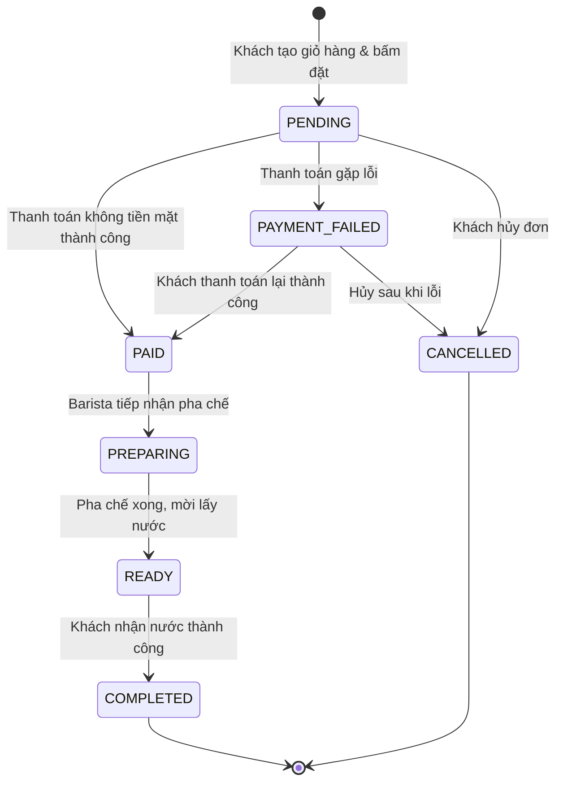

# ☕ BrewLite — Cashless Coffee Ordering Application
> **BÀI TẬP LỚN MÔN CÔNG NGHỆ PHẦN MỀM — VER 1.0**  
> **Khoa Công nghệ Thông tin — Trường Đại học Sài Gòn**  
> **Học kỳ:** I – Năm học 2026–2027

[](docs/scrum/sprint-plan.md)
[](https://nextjs.org/)
[](https://nestjs.com/)
[](https://www.prisma.io/)
[](docker-compose.yml)

---

## 📖 1. Giới Thiệu Dự Án (Product Vision)

> *“BrewLite giúp khách hàng đặt và thanh toán đồ uống không dùng tiền mặt chỉ trong vài chạm, giảm thời gian xếp hàng và nhận đơn nhanh tại quầy.”*

Dự án được xây dựng theo mô hình **Monorepo**, áp dụng quy trình phát triển phần mềm **Agile Scrum** toàn diện qua 3 Sprint với 10 Task Backlog từ khâu phân tích yêu cầu, thiết kế kiến trúc, hiện thực tính năng đến kiểm thử và bàn giao sản phẩm MVP.

---

## 👥 2. Thông tin nhóm

| STT | Họ và tên | MSSV | Vai trò Scrum |
| :-: | :--- | :--- | :--- |
| 1 | _Bùi Hoàng Việt_ | _3124410403_ | Product Owner |
| 2 | _Đinh Đào Thái Sơn_ | _3123410306_ | Scrum Master |
| 3 | _Nguyễn Quang Đạt_ | _3122410071_ | Development Team |
| 4 | _Hoàng Gia Bảo_ | _3124410013_ | Development Team |
| 5 | _Trần Minh Trí_ | _3124410372_ | Development Team |
| 6 | _Cao Thanh Duy_ | _3123410054_ | Development Team |

- **Giảng viên hướng dẫn:** _Từ Lãng Phiêu_
- **Repository:** [_Brew-lite_](https://github.com/buihoangviet2982006-dotcom/Brew-lite.git)

---

## 👥 3. Các Bên Liên Quan (Stakeholders)

* **Khách hàng (Customer):** Xem menu, tùy chọn size/topping, thêm giỏ hàng, thanh toán không tiền mặt và theo dõi trạng thái đơn hàng.
* **Quản lý / Product Owner (PO):** Định hướng yêu cầu, ưu tiên Product Backlog và nghiệm thu Increment sau mỗi Sprint.
* **Nhóm phát triển (Development Team):** Thiết kế kiến trúc, lập trình frontend/backend, viết unit/integration test và thiết lập CI/CD, Docker.
* **Nhân viên quầy / Barista:** Tiếp nhận đơn sau khi thanh toán thành công, cập nhật trạng thái pha chế (PREPARING → READY)
* **Giảng viên nghiệm thu:** Đóng vai trò khách hàng/chuyên gia đánh giá quy trình Agile Scrum, chất lượng mã nguồn và sản phẩm bàn giao.
* **Cổng thanh toán (Mock Payment):** Mô phỏng dịch vụ thanh toán Ví điện tử (Momo/ZaloPay) hoặc Thẻ ngân hàng qua cơ chế Idempotent.

---

## 🏗️ 4. Kiến Trúc & Công Nghệ (Tech Stack)

```
[ Frontend: Next.js (SSR/CSR) + TailwindCSS ]
                     │  ▲
           REST/JSON │  │
                     ▼  │
[ Backend: NestJS (TypeScript) + REST API ] ───► [ Payment Gateway (Mock) ]
                     │
           Prisma ORM│
                     ▼
       [ Database: PostgreSQL 16 ]
```

| Thành Phần | Công Nghệ Sử Dụng | Ghi Chú |
| :--- | :--- | :--- |
| **Frontend** | **Next.js 14**, React, TypeScript, TailwindCSS, Zustand | Quản lý state giỏ hàng, SSR/CSR, Responsive |
| **Backend** | **NestJS**, TypeScript, REST API, Class-Validator, JWT | Kiến trúc module hóa, bảo mật JWT Guard |
| **Cơ sở dữ liệu** | **PostgreSQL 16**, Prisma ORM | Quản lý quan hệ bảng, migrations dữ liệu |
| **Thanh toán** | Mock Payment Service | Mô phỏng xử lý Idempotent, tránh charge trùng |
| **DevOps** | Docker Compose, Git branching, Multi-stage build | Môi trường đồng nhất dev và bàn giao |

---

## 📁 5. Cấu Trúc Thư Mục (Monorepo Structure)

```text
Brew-lite/
├── .github/                     # GitHub workflows / CI/CD (nếu có)
├── backend/                     # Backend Source Code (NestJS)
│   ├── prisma/                  # Prisma schema và migrations
│   │   └── schema.prisma        # Mô hình CSDL (User, Product, Order, Payment)
│   ├── src/
│   │   ├── common/              # Guards, Interceptors, Filters, State Machine
│   │   ├── modules/
│   │   │   ├── auth/            # Module xác thực JWT, bcrypt (Task 7)
│   │   │   ├── products/        # Module sản phẩm & menu (Task 2)
│   │   │   ├── orders/          # Module đơn hàng (Task 6, 10)
│   │   │   └── payments/        # Module thanh toán Mock Idempotent (Task 8)
│   │   ├── app.controller.ts    # Controller gốc (Hello/Health endpoint)
│   │   ├── app.module.ts        # Root Module
│   │   ├── app.service.ts       # Service gốc
│   │   └── main.ts              # Entrypoint ứng dụng NestJS
│   ├── .env.example             # Biến môi trường mẫu cho Backend
│   ├── Dockerfile               # Dockerfile cho Backend
│   ├── package.json
│   └── tsconfig.json
├── frontend/                    # Frontend Source Code (Next.js)
│   ├── public/                  # Static assets (ảnh, icons)
│   ├── src/
│   │   ├── app/                 # Next.js App Router (pages, layout)
│   │   │   ├── globals.css      # CSS styles
│   │   │   ├── layout.tsx       # Root layout
│   │   │   └── page.tsx         # Trang chủ / Hello MVP (Task 1, 3)
│   │   ├── components/          # Reusable UI components
│   │   │   ├── common/          # Header, Navbar, Modal, Badge
│   │   │   ├── menu/            # MenuGrid, ProductCard, OptionsModal
│   │   │   └── cart/            # CartDrawer, OrderSummary, PaymentSelection
│   │   ├── hooks/               # Custom hooks (useCart, useAuth)
│   │   ├── lib/                 # API client utilities (fetchApi)
│   │   └── types/               # Type definitions (Product, Order, User)
│   ├── .env.example             # Biến môi trường mẫu cho Frontend
│   ├── Dockerfile               # Dockerfile cho Frontend
│   ├── next.config.js
│   ├── tailwind.config.js
│   ├── package.json
│   └── tsconfig.json
├── docs/                        # Tài liệu dự án
│   ├── architecture/            # Kiến trúc hệ thống, State Machine, API docs
│   │   ├── api-endpoints.md     # Danh sách endpoints và data models
│   │   └── order-state-machine.md # Sơ đồ máy trạng thái đơn hàng
│   └── scrum/                   # Tài liệu quản lý Scrum
│       ├── definition-of-done.md # Tiêu chí hoàn thành (DoD)
│       └── sprint-plan.md       # Chi tiết 3 Sprints và 10 Task Backlog
├── .env.example                 # Biến môi trường chung cho toàn bộ dự án
├── .gitignore                   # Cấu hình bỏ qua các tệp không cần thiết
├── docker-compose.yml           # Thiết lập chạy cả hệ thống (FE + BE + DB)
├── package.json                 # Monorepo NPM Workspaces
└── README.md                    # Tài liệu hướng dẫn chính
```

---

## 🔄 6. Quy Trình Agile Scrum & Product Backlog

Dự án chia làm **3 Sprint** bám sát kế hoạch đề ra trong đề bài:

```
[Product Backlog] ─► [Sprint Planning] ─► [Sprint Backlog] ─► [Sprint (1-2w)]
                                                                    │
[Sprint Retrospective] ◄── [Sprint Review] ◄── [Increment] ◄────────┘
                                            (Bản chạy được)
```

| Sprint | Mục Tiêu (Sprint Goal) | Task Chi Tiết | Điểm |
| :--- | :--- | :--- | :---: |
| **Sprint 1** | **Nền tảng & Hiển thị menu** | • **Task 1:** Khởi tạo dự án monorepo (FE + BE + README + Git + .env)<br>• **Task 2:** API danh sách sản phẩm `GET /products`<br>• **Task 3:** Trang Menu Frontend render sản phẩm kèm loading/empty<br>• **Task 4:** Modal Chi tiết món & tùy chọn Size/Topping tính giá | **4.0** |
| **Sprint 2** | **Giỏ hàng & Đặt đơn & Đăng nhập** | • **Task 5:** Giỏ hàng (Zustand), thêm/sửa/xóa, tự tính tổng tiền, badge<br>• **Task 6:** API tạo đơn hàng `POST /orders` (PENDING), validate input<br>• **Task 7:** Auth JWT `POST /auth/register`, `/auth/login`, bcrypt hash, Guard | **3.0** |
| **Sprint 3** | **Thanh toán, Bàn giao & Nghiệp vụ nâng cao** | • **Task 8:** Thanh toán không tiền mặt `POST /payments` (PAID / PAYMENT_FAILED)<br>• **Task 9:** Xác nhận đơn, lịch sử đơn `GET /orders/me`, Docker, Demo bàn giao<br>• **Task 10:** Backend nâng cao: State Machine, Idempotent, Quản lý tồn kho Optimistic Locking, Loyalty Points | **3.0** |
| **Tổng** | | **10 Hạng mục Backlog (Hoàn thành Definition of Done)** | **10.0** |

---

## 🌿 7. Chiến Lược Phân Nhánh Git (Git Branching Strategy)

Dự án áp dụng mô hình nhánh kết hợp chuẩn **Agile Git Flow**:

```text
main (Production / Release sau mỗi Sprint Review)
  │
  ├── develop (Tích hợp Sprint Increment)
  │     │
  │     ├── sprint/sprint-1-menu-foundation
  │     │     ├── feature/task-1-project-setup
  │     │     ├── feature/task-2-product-api
  │     │     ├── feature/task-3-menu-frontend
  │     │     └── feature/task-4-product-detail-options
  │     │
  │     ├── sprint/sprint-2-cart-order-auth
  │     │     ├── feature/task-5-cart-management
  │     │     ├── feature/task-6-order-api
  │     │     └── feature/task-7-auth-jwt
  │     │
  │     └── sprint/sprint-3-payment-advanced
  │           ├── feature/task-8-cashless-payment
  │           ├── feature/task-9-order-confirmation-history
  │           └── feature/task-10-backend-advanced-business
```

### Quy ước đặt tên nhánh:
* `main`: Bản phát hành chính thức, chỉ merge sau khi được PO/Giảng viên nghiệm thu.
* `develop`: Nhánh tích hợp chính của toàn bộ nhóm trong quá trình phát triển.
* `sprint/sprint-<số>-<tên>`: Nhánh gom các tính năng của từng Sprint cụ thể.
* `feature/task-<số>-<tên-ngắn>`: Nhánh làm việc cho từng Task / User Story riêng lẻ.
* `hotfix/<tên-lỗi>`: Nhánh sửa lỗi khẩn cấp trên `main`.

### Quy chuẩn thông điệp Commit (Conventional Commits):
* `feat(task-X): <nội dung tính năng mới>`
* `fix(task-X): <sửa lỗi>`
* `docs: <cập nhật tài liệu>`
* `refactor: <tối ưu code>`
* `test: <viết thêm unit/integration test>`

---

## ⚡ 8. Hướng Dẫn Cài Đặt & Khởi Chạy (Getting Started)

### Yêu cầu hệ thống:
* **Node.js** >= 18.x
* **NPM** >= 9.x
* **Docker & Docker Compose** (khuyến nghị cho môi trường DB và Full-stack)

### Cách 1: Chạy bằng Docker Compose (Khuyên dùng)
```bash
# 1. Sao chép biến môi trường
cp .env.example .env
cp backend/.env.example backend/.env
cp frontend/.env.example frontend/.env

# 2. Khởi chạy toàn bộ dịch vụ (PostgreSQL + Backend + Frontend)
docker compose up -d --build

# 3. Khởi tạo CSDL và nạp dữ liệu mẫu (Seed Data)
docker compose exec backend npx prisma db push
docker compose exec backend npx prisma db seed
```
* **Frontend:** [http://localhost:3000](http://localhost:3000)
* **Backend API:** [http://localhost:4000/api](http://localhost:4000/api)
* **Backend Health Check:** [http://localhost:4000/api/health](http://localhost:4000/api/health)

---

### Cách 2: Chạy Local Development

#### 1. Khởi chạy Cơ sở dữ liệu PostgreSQL
```bash
docker run --name brewlite-postgres -e POSTGRES_USER=brewlite_admin -e POSTGRES_PASSWORD=brewlite_secure_password -e POSTGRES_DB=brewlite_db -p 5432:5432 -d postgres:16-alpine
```

#### 2. Cài đặt và chạy Backend (NestJS)
```bash
cd backend
npm install
npx prisma generate
npx prisma db push
npx prisma db seed
npm run start:dev
```

#### 3. Cài đặt và chạy Frontend (Next.js)
```bash
cd frontend
npm install
npm run dev
```
### Biến môi trường chính

| Biến | Nơi dùng | Mô tả |
| :--- | :--- | :--- |
| `DATABASE_URL` | backend | Chuỗi kết nối PostgreSQL |
| `JWT_SECRET` | backend | Khóa ký JWT |
| `JWT_EXPIRATION` | backend | Thời hạn token |
| `BACKEND_PORT` | backend | Cổng API (mặc định 4000) |
| `NEXT_PUBLIC_API_URL` | frontend | URL của Backend API |

---

## 🚦 9. Máy Trạng Thái Đơn Hàng (Order State Machine)

Theo Task 10 và Mục 9 của đề bài, đơn hàng tuân thủ quy tắc chuyển trạng thái nghiêm ngặt:



---

## 🧪 10. Kiểm thử (Testing)

Task 10 yêu cầu có unit/integration test chứng minh:

| # | Tiêu chí | Loại test |
| :-: | :--- | :--- |
| (a) | Chặn được chuyển trạng thái sai (vd. `PENDING → READY`) | Unit test State Machine |
| (b) | Gửi 2 lần cùng `Idempotency-Key` chỉ tạo **1 đơn** | Integration test `POST /payments` |
| (c) | Đặt đồng thời không vượt quá tồn kho | Integration test đồng thời |

```bash
cd backend
npm run test        # unit test
npm run test:e2e    # integration / e2e test
```
---

## ✅ 11. Definition of Done (DoD)
Một Task được tính điểm khi thỏa mãn:
1. Code chạy được, không lỗi build; tuân theo tiêu chí chấp nhận của task.
2. Có commit trên Git với mô tả rõ ràng; được review trong nhóm.
3. API có validate đầu vào (`class-validator`); UI xử lý trạng thái loading/lỗi cơ bản.
4. Có hướng dẫn chạy trong README.