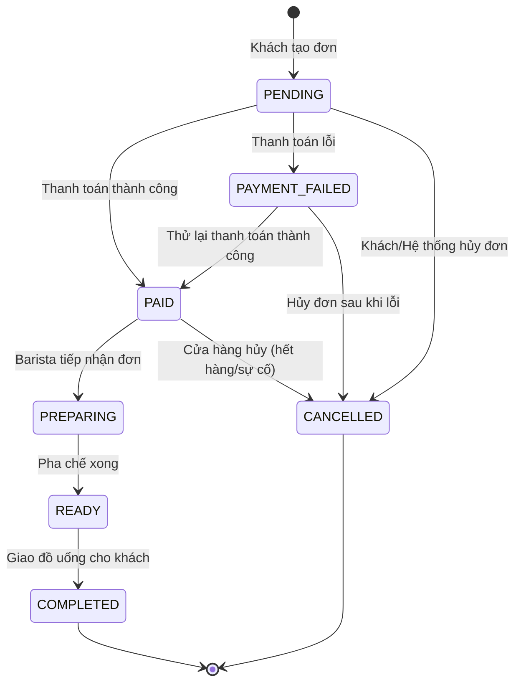

# Sơ Đồ Máy Trạng Thái Đơn Hàng (Order State Machine)

## 1. Các Trạng Thái Hợp Lệ

| Trạng Thái | Ý Nghĩa | Ghi Chú |
| :--- | :--- | :--- |
| `PENDING` | Đơn hàng mới tạo, đang chờ thanh toán | Trạng thái khởi tạo (Start) |
| `PAID` | Đã thanh toán thành công qua ví/thẻ | Chờ Barista tiếp nhận |
| `PREPARING` | Barista đang pha chế thức uống | Trạng thái mở rộng |
| `READY` | Thức uống đã xong, sẵn sàng nhận tại quầy | Thông báo cho khách |
| `COMPLETED` | Khách đã nhận đồ uống | **Trạng thái kết thúc** |
| `PAYMENT_FAILED`| Giao dịch thanh toán thất bại | Có thể thử lại (`retry`) hoặc hủy |
| `CANCELLED` | Đơn hàng đã bị hủy bỏ | **Trạng thái kết thúc** |

---

## 2. Sơ Đồ Chuyển Trạng Thái (Mermaid Diagram)

---

## 3. Quy Tắc Chuyển Tiếp (assertTransition)
- Mọi chuyển tiếp trạng thái không có trong sơ đồ bắt buộc phải bị hàm `assertTransition()` chặn lại và ném lỗi `BadRequestException`.
- `COMPLETED` và `CANCELLED` là trạng thái kết thúc (Final States), không thể chuyển tiếp sang bất kỳ trạng thái nào khác.
